# Physical-Project-mk2

[](https://github.com/choBottle/Physical-Project-mk2/actions/workflows/ci.yml)
[](https://github.com/choBottle/Physical-Project-mk2/actions/workflows/deploy-smoke.yml)
[](https://github.com/choBottle/Physical-Project-mk2/releases)
[](LICENSE)

[English](README.md)

[설치](#설치) • [빠른 시작](#빠른-시작) • [문서](#문서) • [갤러리](#갤러리) • [기여](CONTRIBUTING.md) • [보안](SECURITY.md)

[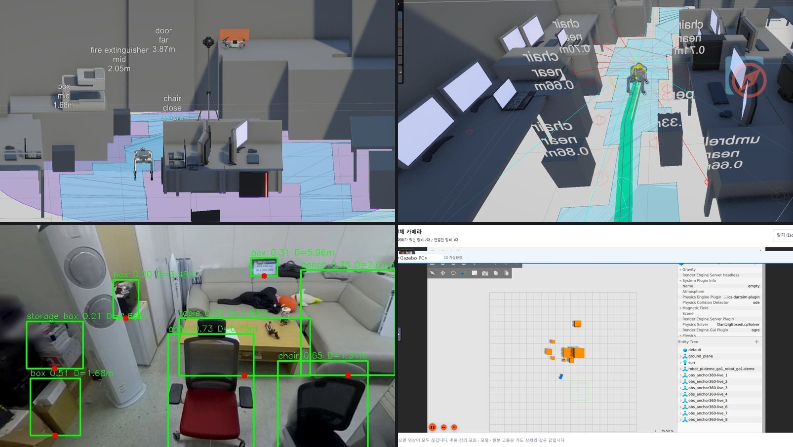](docs/assets/readme-hero.jpg)

## 소개

Physical-Project-mk2 는 재난 대응·기반시설 현장을 위한 엣지-클라우드 피지컬 AI 플랫폼이다. 센서, 보행 로봇, 드론,
360도 카메라가 구역 엣지 노드로 데이터를 보내면, 중앙 서버가 이를 저장하고 관제 화면과 Unity 디지털 트윈에 내보내며,
장치와 서버 자신을 함께 관측한다.

데이터는 성격에 따라 경로가 정해진다. 업무 데이터(장치 상태, 사건, 임무 기록)는 엣지에서 MQTT, 중앙에서 Kafka 를 거쳐
TimescaleDB(계측)와 MySQL(레지스트리, 감사, 임무 기록)에 쌓인다. 관측 데이터(metric, log, trace)는 OpenTelemetry 를 거쳐
Prometheus, Loki, Tempo 로 간다. 영상은 별도 중계 경로를 쓰고, 브라우저는 WebSocket 으로 실시간 상태와 영상을 받는다.
파트 사이의 약속은 [`server/contracts/common/`](server/contracts/common/) 의 JSON Schema 다. MQTT, Kafka,
OpenTelemetry, Tailscale 은 지금 쓰는 구현이고 고정된 의존이 아니다.

중앙 스택은 컨테이너 13개이며 `docker compose` 명령 하나로 뜬다. 모든 PR 마다 CI 가 빈 러너에서 이 스택을 새로 세우고
헬스체크, 실제 말단 노드 코드로 하는 전 구간 시험, 백엔드 회귀 시험, 백업·복구 왕복을 돌린다.

현재 판은 후보판 `v1.0.0-rc.3` 이다. 인증, 역할 기반 접근 제어, TLS 는 아직 없으므로 그 전까지는 사설망이나 터널
안에서만 운영한다([보안](#보안)).

### 1.0.0-rc.3 에서 바뀐 것

- **엣지 → 중앙 MQTT 브리지.** 엣지 브로커가 장치 토픽을 중앙으로 넘기고 명령을 받아 온다. 실제 중앙 스택과 CI 에서
  확인했다([docs/deployment/edge.md](docs/deployment/edge.md)).
- **현장 설정을 지키는 업그레이드.** 현장 수정은 gitignore 된 override 파일에 두고, `deploy/scripts/migrate.sh` 가
  DB 스키마 판을 추적한다. [operations.md](docs/deployment/operations.md) 의 업그레이드 절차를 rc.2 → 이 판으로
  그대로 돌려 데이터가 남는 것을 확인했다.
- **보안 수정.** 360 카메라 업로드 수신기가 `..` 경로를 거부하고 크기 상한을 두며 loopback 밖에서는 토큰을 요구한다.
  촬영본 아카이브 크기 상한, 백엔드 MQTT 계정(선택).
- **명령 규격 하나로.** 하드웨어 · 관제 화면 · AI 가 `physical_command.proto` 하나를 쓰고, CI 가 어긋남을 막는다.
- **폐쇄망 설치**([offline.md](docs/deployment/offline.md)), 영문 배포 문서([docs/en/](docs/en/)), amd64 · arm64 백엔드 이미지.
- **rc.2 에서 올릴 때** `CHANGELOG.md` 의 "Deployment changes" 를 먼저 본다: `./scripts/migrate.sh` 한 번,
  360 카메라 수신기의 `MK2_PANO_BIND` · `MK2_PANO_TOKEN`, 엣지의 `MK2_CENTRAL_MQTT_HOST`.

## 저장소 구성

각 폴더는 원래 팀별 브랜치였고 히스토리를 보존한 채 합쳤다(`git log -- server/` 로 한 파트의 이력을 본다).

| 폴더 | 내용 |
|------|------|
| [`server/`](server/) | 백엔드: MQTT 수집, 저장, WebSocket 게이트웨이, 촬영본 수신, 공통 데이터 규격, DB 스키마 |
| [`hardware/`](hardware/) | 라즈베리파이 센서·로봇(Unitree Go1, DJI RoboMaster EP)·액추에이터 노드, Unity 브리지, 엣지 참조 구성 |
| [`ai/`](ai/) | `perception-framework`: 능력 기반 인지, 위험 판단, 계획, DEVS 시뮬레이터 |
| [`visualization/`](visualization/) | `viz-debugger` 관제 화면(드론 SAR 화면 포함), 화면 계약, 음성·생성 실험 |
| [`drone/`](drone/) | PX4 합성개구레이더(SAR) 패스, RTK 중계, 비행 데이터, 레이더 연동 |
| [`camera360/`](camera360/) | Insta360 앵커 카메라: 파노라마 촬영, 지면 좌표 장애물 검출, Unity 로 UDP 전송 |
| [`osmocam/`](osmocam/) | DJI Osmo 카메라를 무선 MJPEG 소스로 (MIT 프로젝트의 포크) |
| [`deploy/`](deploy/) | 중앙·엣지 Compose 스택, 관측 설정, DB 초기화, 운영 스크립트 |
| [`docs/`](docs/) | 배포 가이드, 포트 레지스트리, 릴리스 정책, 공개 준비 기록 |

## 설치

중앙 서버에는 Docker 만 있으면 된다.

```
git clone https://github.com/choBottle/Physical-Project-mk2
cd Physical-Project-mk2/deploy
./scripts/init-env.sh
docker compose up -d --build --wait
```

`init-env.sh` 가 비밀번호와 토큰을 만들어 `deploy/.env` 에 쓴다. 비밀값은 이 파일에만 있고 커밋하지 않는다. 처음
기동할 때 백엔드 이미지를 빌드하므로 3~5분 걸린다.

빌드 대신 공개된 백엔드 이미지를 쓰려면 `deploy/.env` 에 `MK2_BACKEND_IMAGE=ghcr.io/chobottle/mk2-backend:<버전>` 을
넣고 `docker compose up -d --wait` 를 실행한다. 이미지는 로그인 없이 받아진다.

중앙 스택은 x86-64 와 64비트 ARM(arm64/aarch64) 호스트 둘 다에서 돈다. 릴리스 이미지는 `linux/amd64`·`linux/arm64` 로
게시되고, `deploy/docker-compose.yml` 의 고정 서드파티 이미지도 모두 arm64 판이 있어 Docker 가 맞는 쪽을 받는다.
arm64 에서 소스로 빌드해도 같다 — 백엔드 의존성은 미리 빌드된 휠로 설치된다.

Windows 에서는 Git Bash 나 WSL2 에서 스크립트를 실행한다. Git Bash 에서는 먼저 `export MSYS_NO_PATHCONV=1` 을
실행한다 — 문서의 `docker compose exec … /opt/…` · `promtool check config /etc/prometheus/…` 같은 명령에서 Git Bash 가
컨테이너 안 경로를 Windows 경로로 바꾸지 않게 한다.

`deploy/.env` 의 `COMPOSE_PROJECT_NAME`(기본 `mk2`)이 볼륨 이름 앞에 붙는다(`mk2_mysql_data` …). 같은 호스트에 이전
배포의 볼륨이 남아 있으면 새 배포가 그 볼륨과 옛 DB 비밀번호를 그대로 쓴다 — `init-env.sh` 가 경고를 찍는다.
[배포 가이드 §3](docs/deployment/README.md#3-설치--다섯-단계).

## 요구 사항

중앙 서버:

- Docker Engine, Compose v2.24 이상
- 최소 4코어, 8 GB. 상시 운영은 8코어, 16 GB, SSD 200 GB 이상 권장
- 고정 이미지: Apache Kafka 4.1.0, Eclipse Mosquitto 2.0.22, MySQL 8.4, TimescaleDB 2.30.0 (PostgreSQL 16),
  OpenTelemetry Collector Contrib 0.150.1, Prometheus 3.9.1, Grafana 12.2.0, Loki 3.5.5, Tempo 2.8.2

파트를 컨테이너 밖에서 개발·실행할 때만 필요한 것:

- Python 3.10 이상(`ai/perception-framework`, `drone/`), CI 는 3.12
- Node.js 22 (`visualization/viz-debugger`)
- 장치 노드는 Python 3 이 있는 Raspberry Pi OS. Go1 노드는 Unitree Legged SDK 가 추가로 필요하다(저장소에 없다)
- camera360 비전 서버는 CUDA GPU (`requirements-vision.txt`)

전 구간 시험(`deploy/scripts/e2e-sim.sh`):

- `python:3.12-slim` 이미지를 받는다
- 그 컨테이너 안에서 노드 라이브러리를 pip 로 설치하므로 인터넷이 필요하다. 폐쇄망이면 `MK2_WHEELHOUSE=<휠 디렉터리>`
  (`bundle-offline.sh` 가 만드는 `wheels/e2e`)를 주어 PyPI 대신 거기서 설치한다 — [폐쇄망 설치](docs/deployment/offline.md)

## 빠른 시작

`docker compose up` 뒤 `deploy/` 에서:

```
./scripts/seed-demo.sh       # 선택: 데모 구역 2개와 장치 선언
./scripts/healthcheck.sh     # 35항목
./scripts/e2e-sim.sh         # 10항목, pip 설치에 인터넷 필요(MK2_WHEELHOUSE 를 주면 불필요)
```

`healthcheck.sh` 는 서비스가 떠 있는지, 시험 메시지가 MQTT → Kafka → TimescaleDB · MySQL 까지 가는지, metric · log ·
trace 가 저장소에 닿는지, 앱 DB 계정이 감사·임무 기록을 고치지 못하는지 본다. 성공하면 `결과: 통과 35 · 실패 0` 을 찍는다.

운영 스크립트는 진행과 결과를 한국어로 찍는다. 항목마다 ✅(통과) 또는 ❌(실패)로 시작하고, `healthcheck.sh`·`e2e-sim.sh` 를
끝까지 돌리면 마지막 줄이 `결과: 통과 N · 실패 M` 이다. M 이 0 일 때만 성공이며 그때 종료 코드도 0 이다.

시험 데이터를 보내고 확인하기:

```
docker compose exec be-ingest python tests/publisher.py --host mosquitto --count 10
```

Grafana 는 <http://127.0.0.1:7862> 이다(포트는 `deploy/.env` 의 `MK2_PORT_GRAFANA`). 로그인은 `deploy/.env` 의
`GRAFANA_ADMIN_USER`(기본 `admin`) / `GRAFANA_ADMIN_PASSWORD`(`init-env.sh` 가 생성)다. **MK2 Backend Overview**
대시보드를 연다.

관제 화면으로 실시간 상태 보기:

```
cd visualization/viz-debugger
npm ci
npm run dev
```

연결 관리에서 게이트웨이를 `ws://127.0.0.1:8765/state?token=<MK2_WS_TOKEN>`, 구역을 `zoneA` 로 둔다.

### 전 구간 시험

`e2e-sim.sh` 는 `hardware/pi/sensor/sensor_node.py` 를 고치지 않고 `python:3.12-slim` 컨테이너로 띄워 중앙 스택에
붙인다. 센서 입력만 노드에 내장된 수위 모델과 강우 스위치로 대신한다. 관제 화면과 같은 구독 메시지로 `/state` 를 받아
다음을 확인한다.

- 주기 보고가 도착한다.
- 강우 스위치를 켜면 `threshold_exceeded` 사건과 1 Hz 사건 모드 전환이, 끄면 `threshold_cleared` 와 평시 복귀가 온다.
- TimescaleDB 에 화면이 받은 만큼 이상의 행(두 사건 포함)이 있고, MySQL 에 장치가 등록된다.
- 노드 자신의 metric 이 Prometheus 에 들어온다.

2026-10-27 실행에서 발행부터 화면까지 지연의 중앙값은 9 ms 였다. 물리 센서, 관제 → 장치 명령 경로, 영상은 이 시험의
범위가 아니다. 범위와 실장비 절차는 [docs/deployment/e2e.md](docs/deployment/e2e.md).

## 포트

중앙 스택은 장치 쪽 포트를 `MK2_EDGE_BIND`, 운영자 포트를 `MK2_ADMIN_BIND` 에 묶는다. 둘 다 기본값은 `127.0.0.1` 이다.

| 포트 | 서비스 | 쓰는 쪽 |
|------|--------|---------|
| 1883, 9001 | Mosquitto (MQTT, MQTT over WebSocket) | 장치, 엣지 노드, 브라우저 도구 |
| 4316, 4317, 4318 | OpenTelemetry Collector (OTLP gRPC 4316 · 4317, HTTP 4318) | 백엔드, 장치 노드, AI, 엣지 Collector, 브라우저 |
| 8765 | WebSocket 게이트웨이 `/state`, `/media` | 관제 화면 (토큰) |
| 8766 | WebSocket 게이트웨이 `/ingest` | 엣지 영상 송신 (토큰) |
| 8767 | 촬영본 업로드 `PUT /capture` | 로봇 (토큰) |
| 9095 | Kafka 엣지 리스너 (`MK2_KAFKA_EDGE_BIND`, 1.0 에서는 미사용) | 이후 엣지 Kafka 브릿지 |
| 9092 | Kafka 내부 리스너 (`127.0.0.1` 고정) | 서버 안 호스트 프로세스(pytest) |
| 7858, 7859 | MySQL, TimescaleDB | 운영자 |
| 7861, 7862 | Prometheus, Grafana | 운영자 |
| 3100, 3200 | Loki, Tempo | 운영자 |

엣지 스택과 장치 ↔ Unity 포트까지 포함한 전체 목록은 [docs/PORTS.md](docs/PORTS.md).

## 문서

| 문서 | 내용 |
|------|------|
| [배포 가이드](docs/deployment/README.md) | 요구 사양, 설치, 검증, 문제 해결 |
| [DB](docs/deployment/database.md) | MySQL · TimescaleDB 스키마, 권한, 마이그레이션, 백업·복구 |
| [관측](docs/deployment/observability.md) | metric, log, trace, 대시보드, 알림 규칙, 엣지 페더레이션 |
| [엣지](docs/deployment/edge.md) | 구역 엣지 노드와 장치 노드 설치 |
| [전 구간 시험](docs/deployment/e2e.md) | 범위, 실행 기록, 실장비 절차 |
| [서버 주소 변경](docs/deployment/endpoints.md) | 객체 탐지·스트림·앵커 서버나 Unity PC를 옮겼을 때 바꿀 곳 |
| [트윈 시연](docs/deployment/twin-demo.md) | 360 사진 → 검출 → Gazebo, 콘솔에 Gazebo · 360 카메라 · 로봇 (캡처) |
| [바꿔 끼우기](docs/deployment/pluggability.md) | 다른 360 카메라, 다른 검출 모델, Unity가 아닌 트윈 |
| [보안](docs/deployment/security.md) | 노출 정책, 토큰, 터널, 운영 전환 체크리스트 |
| [운영](docs/deployment/operations.md) | 재기동, 업그레이드, 백업, 알림별 대응 |
| [폐쇄망 설치](docs/deployment/offline.md) | 이미지·저장소·파이썬 휠을 한 묶음으로 반입해 인터넷 없이 설치 |
| [English docs](docs/en/README.md) | 배포 가이드 · 운영 · DB · 보안 · 엣지 영문판 (어긋나면 한국어 문서가 기준) |
| [릴리스 정책](docs/RELEASE.md) | 버전 규칙, 릴리스 절차, 1.0 기준, 1.x 로드맵 |
| [아키텍처](server/docs/be/00-architecture.md) | 백엔드 설계 원칙 |

## 보안

현재 플랫폼은 모든 클라이언트가 신뢰된 사설망이나 터널 안에 있다고 가정한다. MQTT 는 익명 접속을 받고, OTLP 와 Kafka 는
평문이며, 접근은 위의 바인딩 주소와 게이트웨이·촬영본 입구의 토큰으로 제한한다. 이 포트들을 인터넷에 열지 않는다.
인증, RBAC, TLS 는 1.x 로드맵이다.

취약점 신고는 [SECURITY.md](SECURITY.md) 를 따른다.

## 지원과 기여

버그와 배포 문제는 [GitHub Issues](https://github.com/choBottle/Physical-Project-mk2/issues), 질문과 도입 사례는
[Discussions](https://github.com/choBottle/Physical-Project-mk2/discussions) 를 쓴다. 개발 환경, 시험 명령, PR 규칙은
[CONTRIBUTING.md](CONTRIBUTING.md), 메인테이너와 결정 방식은 [GOVERNANCE.md](GOVERNANCE.md) 에 있다.

## 갤러리

#### 디지털 트윈

*왼쪽: 연구실을 옮긴 Unity 디지털 트윈에서 Go1 이 걷는 모습(위에서 본 화면, 파란 영역이 이동 가능 구역, 2배속). 오른쪽: 같은 연구실을 Gazebo 로 옮긴 환경에서 Nav2 가 장애물을 피해 목표까지 자율주행하는 모습(초록: 지나온 경로).*

<a href="docs/assets/g-twin-sim.gif">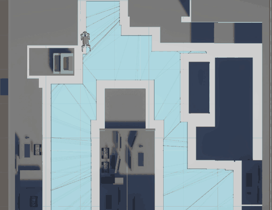</a> <a href="docs/assets/g-gazebo-sim.gif">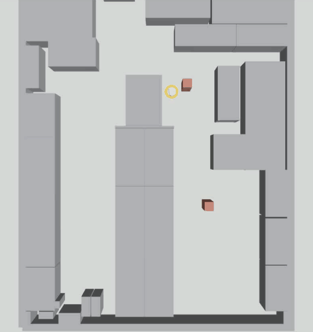</a>

<a href="docs/assets/readme-unity-twin.jpg">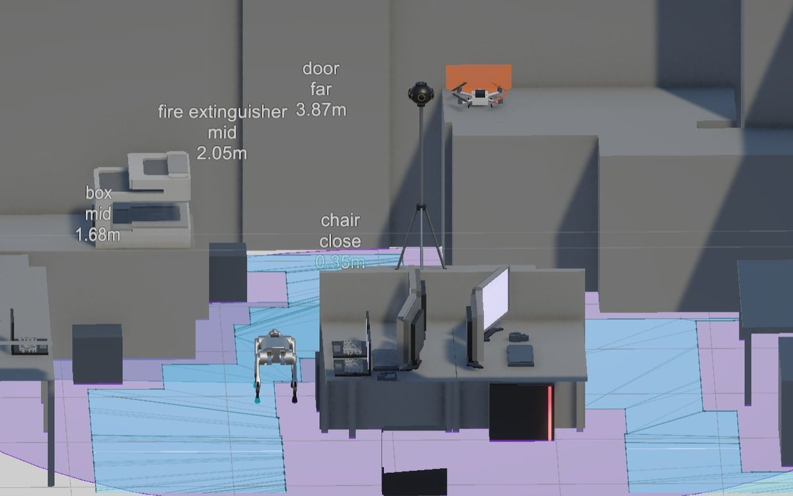</a> <a href="docs/assets/readme-unity-path.jpg">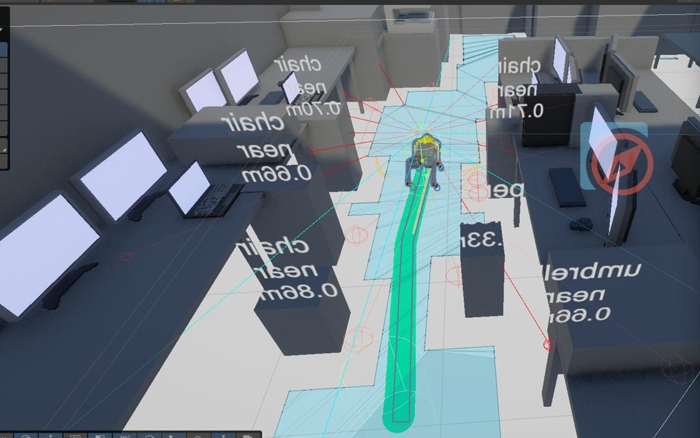</a>

#### 객체 탐지

*360 사진에서 YOLO-World: 시점이 방을 한 바퀴 돌며 보이는 것마다 검출한다 (`camera360/anchor360_live.py`).*

<a href="docs/assets/g-detect-sweep.gif">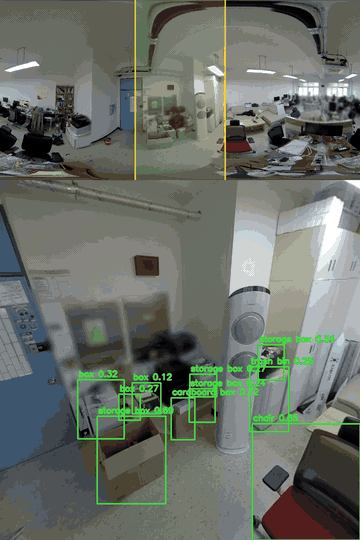</a> <a href="docs/assets/g-detect.jpg">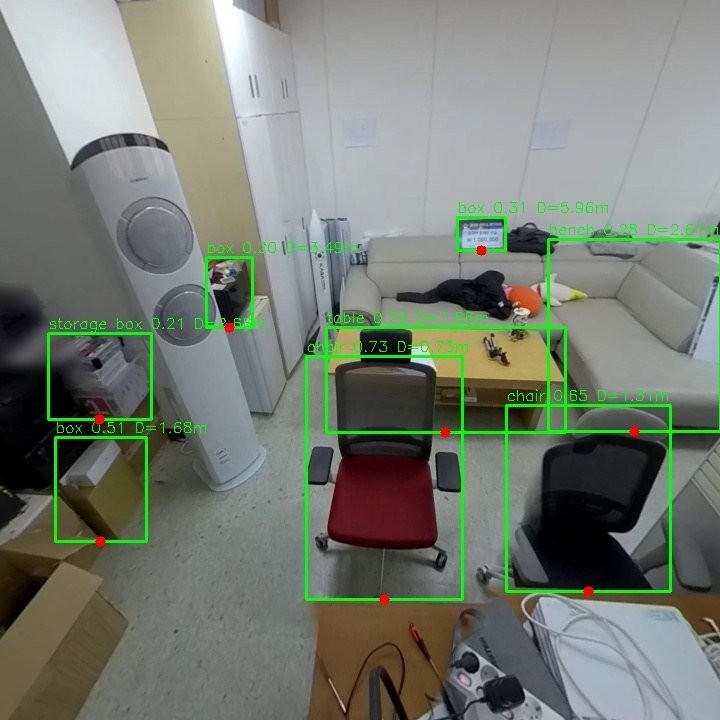</a>

#### 가시화 콘솔

*로봇 · 카메라 · 트윈 화면을 한 콘솔에서 (`visualization/viz-debugger`).*

<a href="docs/assets/readme-console.jpg">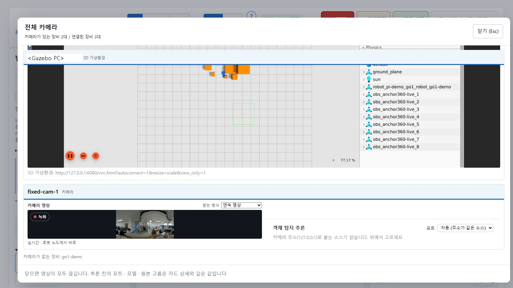</a> <a href="docs/assets/readme-console-devices.jpg">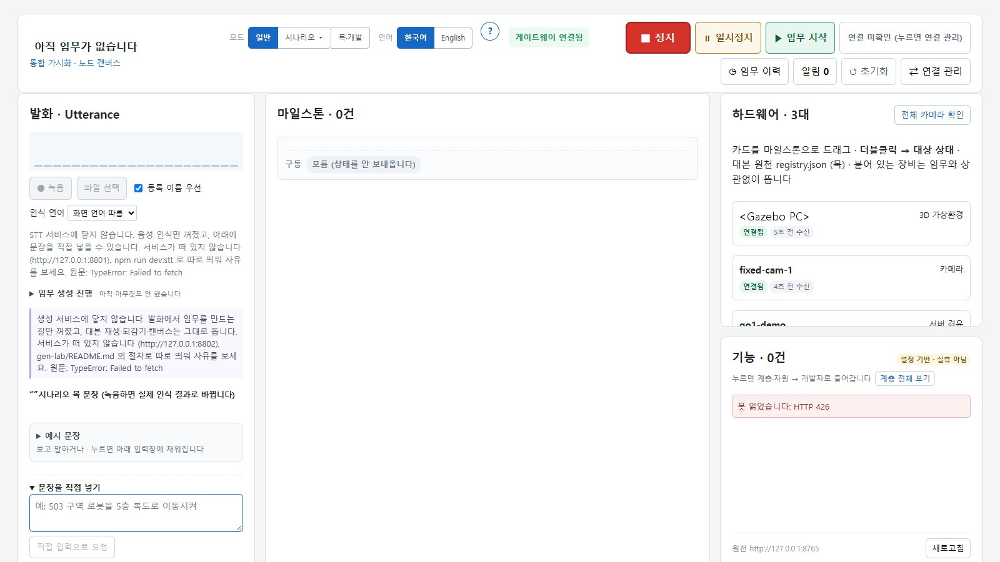</a>

#### 관측

*함께 배포되는 Grafana 위의 MK2 대시보드 (`deploy/server/grafana/dashboards/`).*

[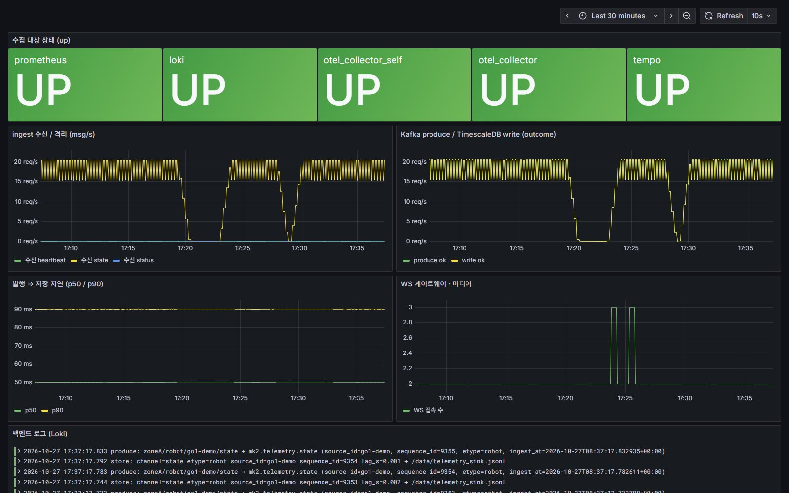](docs/assets/readme-grafana.jpg)

#### 드론 SAR

*드론 레이더 패스를 콘솔에서 비교하고 초점을 맞춘다.*

<a href="drone/screenshots/31_SAR_%ED%8C%A8%EC%8A%A4%EB%B9%84%EA%B5%90.png">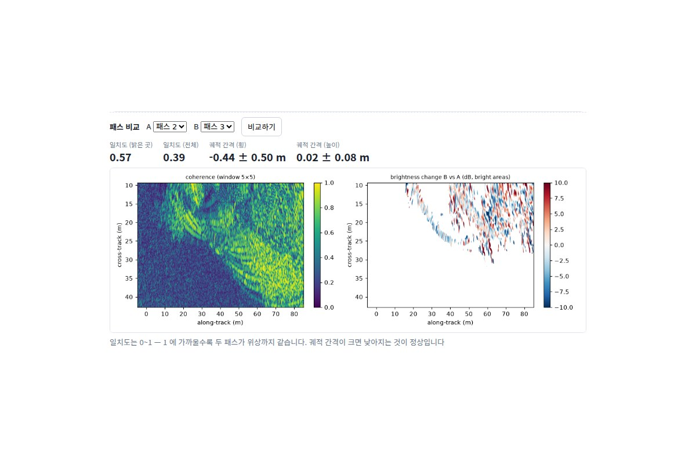</a> <a href="drone/screenshots/13_SAR%EC%98%81%EC%83%81_3_RTK%EC%98%A4%EC%B0%A82cm_%EC%9E%90%EB%8F%99%EC%B4%88%EC%A0%90.png">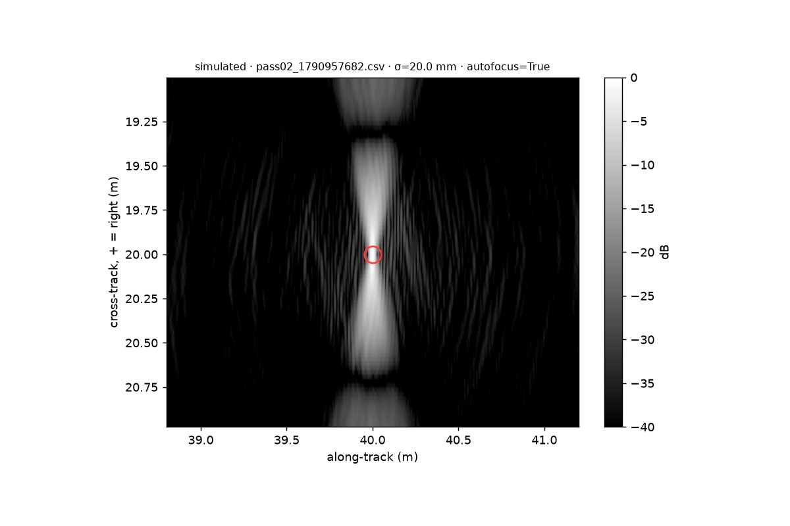</a>

## 인용

이 소프트웨어를 인용할 때는 [CITATION.cff](CITATION.cff) 의 메타데이터를 쓴다.

## 라이선스

Copyright (c) 2026 Sysailab, Hanbat National University, and Physical-Project-mk2 contributors

메인테이너: @daegyu10 (백엔드, camera360), @choBottle (하드웨어, 배포), @JNY03 (AI), @khw18033 (가시화, osmocam),
jhjeong (드론)

라이선스: MIT. 전문은 [LICENSE](LICENSE). 포함된 제3자 구성요소는 각자의 라이선스를 따른다.
[THIRD_PARTY_NOTICES.md](THIRD_PARTY_NOTICES.md).
