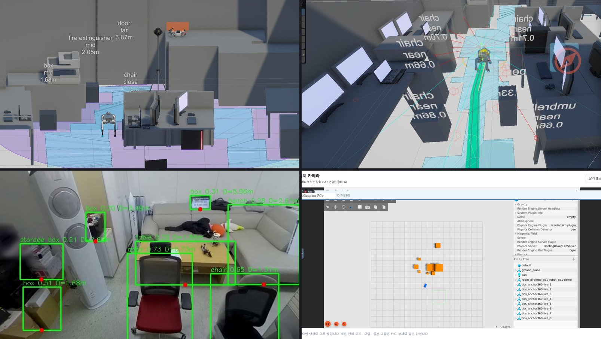
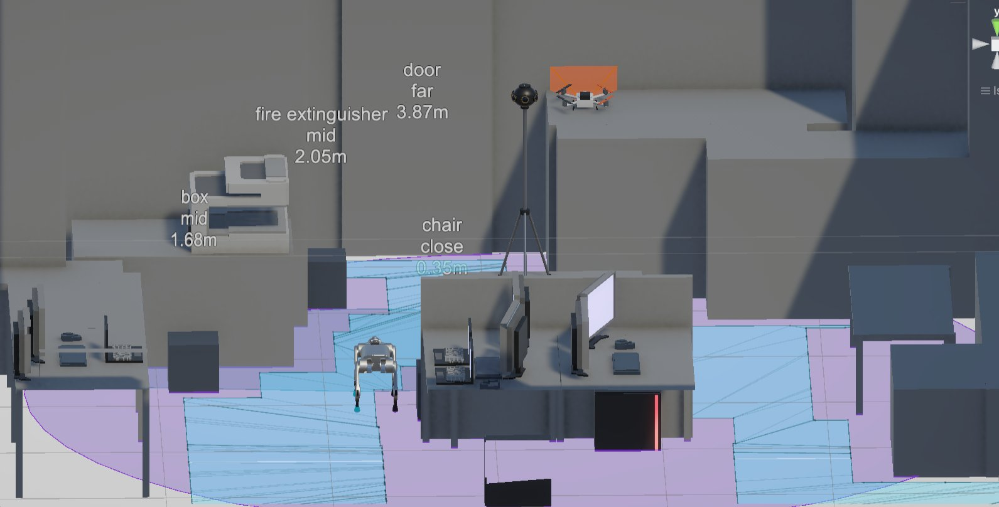
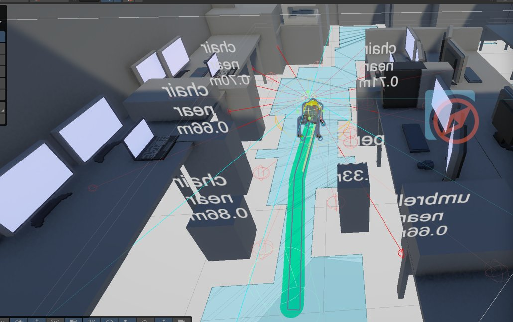
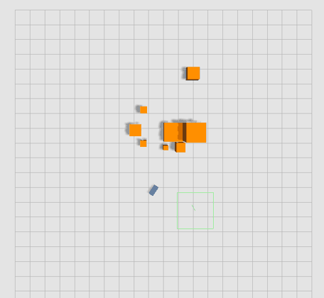
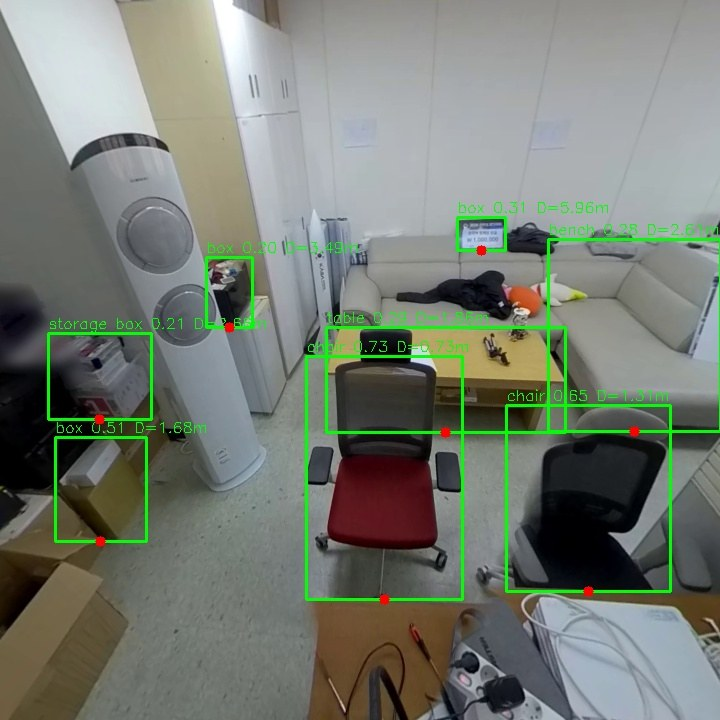
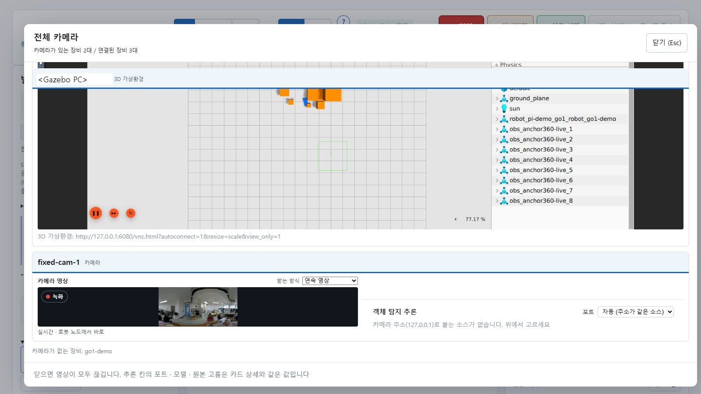
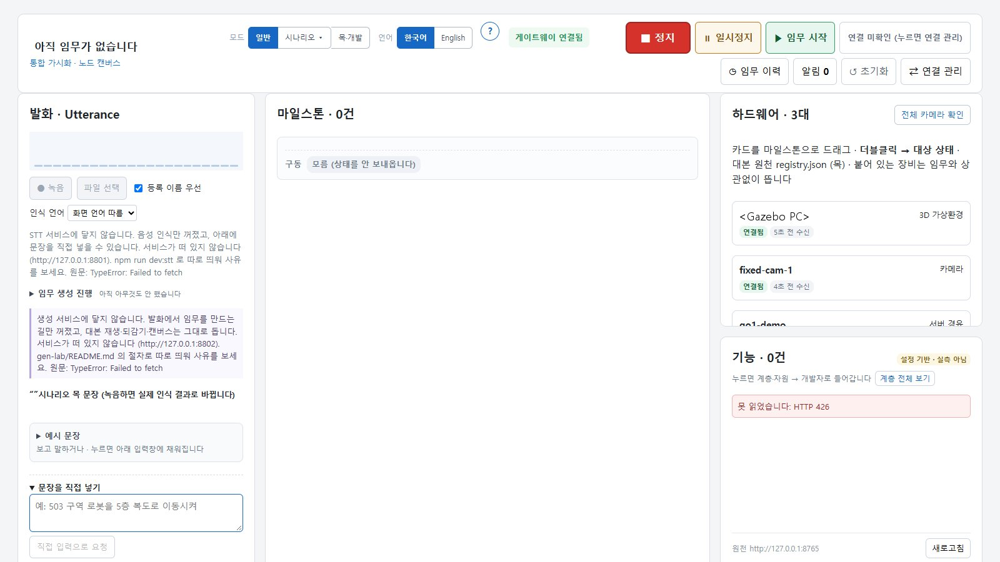
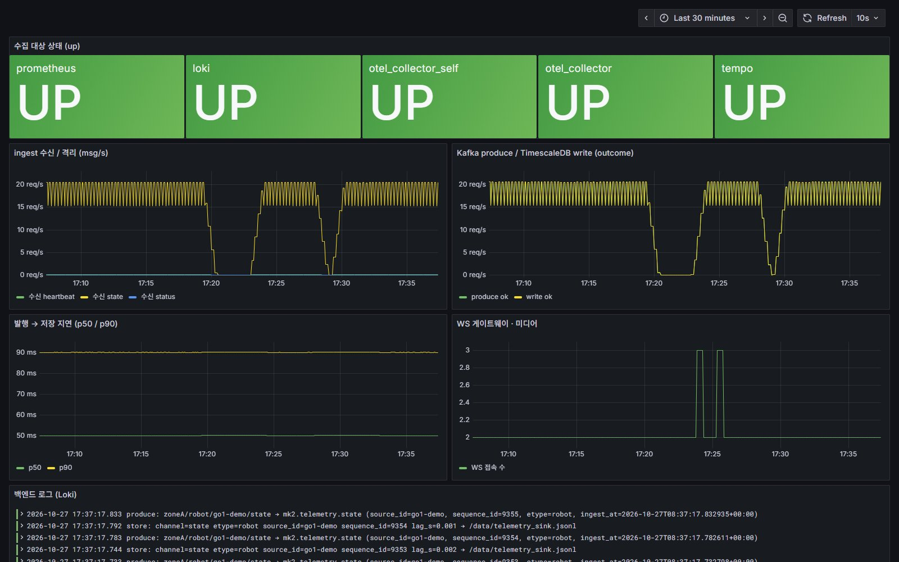

# Physical-Project-mk2

[](https://github.com/choBottle/Physical-Project-mk2/actions/workflows/ci.yml)
[](https://github.com/choBottle/Physical-Project-mk2/actions/workflows/deploy-smoke.yml)
[](https://github.com/choBottle/Physical-Project-mk2/releases)
[](LICENSE)

[한국어](README.ko.md)

[Installing](#installing) • [Quick Start](#quick-start) • [Documentation](#documentation) • [Gallery](#gallery) • [Contributing](CONTRIBUTING.md) • [Security](SECURITY.md)

[](docs/assets/readme-hero.jpg)

## Introduction

Physical-Project-mk2 is an edge-to-cloud platform for physical AI at
disaster-response and infrastructure sites. Sensors, legged robots, drones
and 360-degree cameras publish to a zone edge node; a central server stores
the data, exposes it to operator consoles and a Unity digital twin, and
monitors both the devices and itself.

Data is routed by its nature. Business data (device state, events, mission
records) travels over MQTT at the edge and Kafka in the core, and lands in
TimescaleDB (telemetry) and MySQL (registry, audit, mission records).
Observability data (metrics, logs, traces) travels over OpenTelemetry to
Prometheus, Loki and Tempo. Video uses its own relay path. Browsers receive
live state and video over WebSocket. The interfaces between parts are JSON
Schema contracts in [`server/contracts/common/`](server/contracts/common/);
MQTT, Kafka, OpenTelemetry and Tailscale are the current implementations,
not fixed dependencies.

The central stack is 13 containers started by one `docker compose` command.
Every pull request rebuilds it on an empty CI runner and runs the health
check, an end-to-end test with the real device-node code, the backend
regression suite and a backup/restore round trip.

The current release is `v1.0.0-rc.1`, a release candidate. Authentication,
role-based access control and TLS are not implemented yet; until they are,
run the platform only inside a private network or tunnel (see
[Security](#security)).

### Changes since 1.0.0-rc.1

- **360-degree camera to Unity on data contract v2.** `camera360/anchor360_live.py`
  and the Unity receiver `Anchor360ObstacleReceiver.cs` now use the v2 field
  names (`label`, `position`, `ground_dist_m`, `size_m`, `bbox`,
  `confidence`). The receiver still accepts v1 packets so that the server
  and Unity can be updated on different days.
- **Replaceable parts.** The detector is chosen in configuration, any
  equirectangular 360 camera can upload, stream-server sources come from
  `camera360/sources.json`, and a twin gateway feeds Gazebo or another twin
  next to Unity. See [docs/deployment/pluggability.md](docs/deployment/pluggability.md).
- **One operator console.** The drone team's copy of the console was merged
  into `visualization/viz-debugger`, and the drone Python packages moved to
  [`drone/`](drone/).
- **End-to-end test without hardware.** `deploy/scripts/e2e-sim.sh` runs the
  Raspberry Pi sensor node in a container against the central stack and
  checks that its readings reach the console subscription, the databases
  and Prometheus.
- **Regression fixes** found by comparing the merged repository against the
  original team branches: model paths in the camera360 configuration, empty
  environment variables on the Go1 robot node, and image quality of the
  blurred sample photos. `CHANGELOG.md` lists the details.

## Repository layout

Each top-level folder was a separate team branch and was merged with its
history preserved (`git log -- server/` shows the history of one part).

| Folder | Contents |
|--------|----------|
| [`server/`](server/) | Backend: MQTT ingest, storage writers, WebSocket gateway, capture upload, common data contracts, database schema |
| [`hardware/`](hardware/) | Raspberry Pi nodes for sensors, robots (Unitree Go1, DJI RoboMaster EP) and actuators; Unity bridge; edge reference setup |
| [`ai/`](ai/) | `perception-framework`: capability-based perception, risk assessment and planning, with a DEVS simulator |
| [`visualization/`](visualization/) | `viz-debugger` operator console (including the drone SAR views), console contracts, speech and generation experiments |
| [`drone/`](drone/) | PX4 synthetic aperture radar (SAR) passes, RTK relay, flight data, radar integration |
| [`camera360/`](camera360/) | Insta360 anchor camera: panorama capture, obstacle detection on the ground plane, UDP feed to Unity |
| [`osmocam/`](osmocam/) | DJI Osmo camera as a wireless MJPEG source (fork of an MIT project) |
| [`deploy/`](deploy/) | Central and edge Compose stacks, observability configuration, database initialization, operations scripts |
| [`docs/`](docs/) | Deployment guide, port registry, release policy, open-source readiness record |

## Installing

The central server needs only Docker:

```
git clone https://github.com/choBottle/Physical-Project-mk2
cd Physical-Project-mk2/deploy
./scripts/init-env.sh
docker compose up -d --build --wait
```

`init-env.sh` writes `deploy/.env` with generated passwords and tokens. That
file holds every secret and is not committed. The first start builds the
backend image and takes three to five minutes.

To use a published backend image instead of building it, set
`MK2_BACKEND_IMAGE=ghcr.io/chobottle/mk2-backend:<version>` in `deploy/.env`
and run `docker compose up -d --wait`. The image is public.

On Windows, run the scripts from Git Bash or WSL2.

## Dependencies

Central server:

- Docker Engine with Compose v2.24 or later
- 4 CPU cores and 8 GB RAM minimum; 8 cores, 16 GB and 200 GB of SSD are
  recommended for continuous use
- Pinned images: Apache Kafka 4.1.0, Eclipse Mosquitto 2.0.22, MySQL 8.4,
  TimescaleDB 2.30.0 (PostgreSQL 16), OpenTelemetry Collector Contrib
  0.150.1, Prometheus 3.9.1, Grafana 12.2.0, Loki 3.5.5, Tempo 2.8.2

Parts, needed only to develop or run them outside the containers:

- Python 3.10 or later (`ai/perception-framework`, `drone/`); CI uses 3.12
- Node.js 22 (`visualization/viz-debugger`)
- Raspberry Pi OS with Python 3 for the device nodes; the Go1 node also
  needs the Unitree Legged SDK, which is not distributed here
- A CUDA GPU for the camera360 vision server (`requirements-vision.txt`)

## Quick Start

After `docker compose up`, run the checks from `deploy/`:

```
./scripts/seed-demo.sh       # optional: declare two demo zones and devices
./scripts/healthcheck.sh     # 32 checks
./scripts/e2e-sim.sh         # 10 checks, needs internet access for pip
```

`healthcheck.sh` checks that the services are running, that a test message
passes from MQTT through Kafka into TimescaleDB and MySQL, that metrics,
logs and traces reach their stores, and that the application database
account cannot modify audit and mission records. It prints
`결과: 통과 32 · 실패 0` (32 passed, 0 failed) on success.

Send test data and look at it:

```
docker compose exec be-ingest python tests/publisher.py --host mosquitto --count 10
```

Grafana listens on <http://127.0.0.1:7862>; the login is in `deploy/.env`
(`GRAFANA_ADMIN_*`). Open the **MK2 Backend Overview** dashboard.

To watch live state in the operator console:

```
cd visualization/viz-debugger
npm ci
npm run dev
```

In the console's connection manager, set the gateway to
`ws://127.0.0.1:8765/state?token=<MK2_WS_TOKEN>` and the zone to `zoneA`.

### End-to-end test

`e2e-sim.sh` starts `hardware/pi/sensor/sensor_node.py`, unchanged, in a
`python:3.12-slim` container attached to the central stack. Only the sensor
input is simulated: the node's built-in water-level model and its rain
switch. The script subscribes to `/state` with the same message the console
sends and checks that:

- periodic reports arrive;
- turning the rain switch on produces a `threshold_exceeded` event and a
  switch to the 1 Hz event mode, and turning it off produces
  `threshold_cleared` and a return to normal mode;
- TimescaleDB holds at least as many rows as the console received, including
  both events, and MySQL registers the device;
- the node's own metrics reach Prometheus.

On the 2026-10-27 run the median delay from publish to console was 9 ms. The
test does not cover physical sensors, the command path from console to
device, or video; [docs/deployment/e2e.md](docs/deployment/e2e.md) lists
what it covers and the procedure for a run on real hardware.

## Ports

The central stack binds device-facing ports to `MK2_EDGE_BIND` and operator
ports to `MK2_ADMIN_BIND`; both default to `127.0.0.1`.

| Port | Service | Used by |
|------|---------|---------|
| 1883, 9001 | Mosquitto (MQTT, MQTT over WebSocket) | devices, edge nodes, browser tools |
| 4317, 4318 | OpenTelemetry Collector (gRPC, HTTP) | backend, device nodes, AI, edge collectors, browsers |
| 8765 | WebSocket gateway `/state`, `/media` | operator consoles (token) |
| 8766 | WebSocket gateway `/ingest` | edge video senders (token) |
| 8767 | Capture upload `PUT /capture` | robots (token) |
| 9095 | Kafka edge listener | remote edge bridges |
| 7858, 7859 | MySQL, TimescaleDB | operators |
| 7861, 7862 | Prometheus, Grafana | operators |

[docs/PORTS.md](docs/PORTS.md) is the full registry, including the edge
stack and the ports used between devices and Unity.

## Documentation

| Document | Contents |
|----------|----------|
| [Deployment guide](docs/deployment/README.md) | Requirements, installation, verification, troubleshooting |
| [Database](docs/deployment/database.md) | MySQL and TimescaleDB schema, grants, migrations, backup and restore |
| [Observability](docs/deployment/observability.md) | Metrics, logs, traces, dashboards, alert rules, edge federation |
| [Edge](docs/deployment/edge.md) | Zone edge node and device node installation |
| [End-to-end test](docs/deployment/e2e.md) | Scope, recorded runs, procedure on real hardware |
| [Changing server addresses](docs/deployment/endpoints.md) | What to update when the perception, stream, anchor or Unity host moves |
| [Twin demo](docs/deployment/twin-demo.md) | Recorded run: 360 photo to detection to Gazebo, with Gazebo and the 360 camera inside the operator console (screenshots) |
| [Swapping components](docs/deployment/pluggability.md) | Using another 360 camera, another detection model, or a twin other than Unity |
| [Security](docs/deployment/security.md) | Exposure policy, tokens, tunnel, production checklist |
| [Operations](docs/deployment/operations.md) | Restart, upgrade, backup, response to each alert |
| [Release policy](docs/RELEASE.md) | Versioning, release procedure, 1.0 criteria, 1.x roadmap |
| [Architecture](server/docs/be/00-architecture.md) | Design principles of the backend |

Most documents are written in Korean. Issues and pull requests in English
are welcome.

## Security

The platform currently assumes that every client is inside a trusted private
network or tunnel. MQTT accepts anonymous clients, OTLP and Kafka are
plaintext, and access is limited by the bind addresses above and by tokens on
the gateway and capture endpoints. Do not expose these ports to the
internet. Authentication, RBAC and TLS are on the 1.x roadmap.

Report vulnerabilities as described in [SECURITY.md](SECURITY.md).

## Support and contributing

Use [GitHub Issues](https://github.com/choBottle/Physical-Project-mk2/issues)
for bug reports and deployment problems, and
[Discussions](https://github.com/choBottle/Physical-Project-mk2/discussions)
for questions and adoption reports. See [CONTRIBUTING.md](CONTRIBUTING.md) for
the development setup, test commands and pull-request guidelines, and
[GOVERNANCE.md](GOVERNANCE.md) for maintainers and decision rules.

## Gallery

#### Digital twin

*Unity and Gazebo receive the same packets from the robots and the 360-degree camera.*

<a href="docs/assets/readme-unity-twin.jpg"></a> <a href="docs/assets/readme-unity-path.jpg"></a>

<a href="docs/assets/readme-gazebo.gif"></a> <a href="docs/assets/readme-detect.jpg"></a>

#### Operator console

*Robots, cameras and the twin screen in one console (`visualization/viz-debugger`).*

<a href="docs/assets/readme-console.jpg"></a> <a href="docs/assets/readme-console-devices.jpg"></a>

#### Observability

*The MK2 dashboard (`deploy/server/grafana/dashboards/`) on the bundled Grafana.*

[](docs/assets/readme-grafana.jpg)

#### Drone SAR

*Synthetic aperture radar passes from the drone, compared and focused in the console.*

<a href="drone/screenshots/31_SAR_%ED%8C%A8%EC%8A%A4%EB%B9%84%EA%B5%90.png"></a> <a href="drone/screenshots/13_SAR%EC%98%81%EC%83%81_3_RTK%EC%98%A4%EC%B0%A82cm_%EC%9E%90%EB%8F%99%EC%B4%88%EC%A0%90.png"></a>

## Citing

If you use this software, cite it with the metadata in
[CITATION.cff](CITATION.cff).

## License

Copyright (c) 2026 Sysailab, Hanbat National University, and Physical-Project-mk2 contributors

Maintainers: @daegyu10 (backend, camera360), @choBottle (hardware,
deployment), @JNY03 (AI), @khw18033 (visualization, osmocam), jhjeong (drone)

License: MIT. The full license text is in [LICENSE](LICENSE). Bundled
third-party components keep their own licenses; see
[THIRD_PARTY_NOTICES.md](THIRD_PARTY_NOTICES.md).
