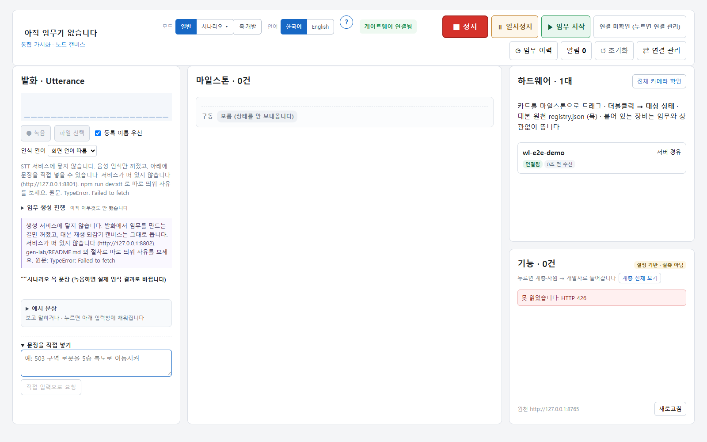
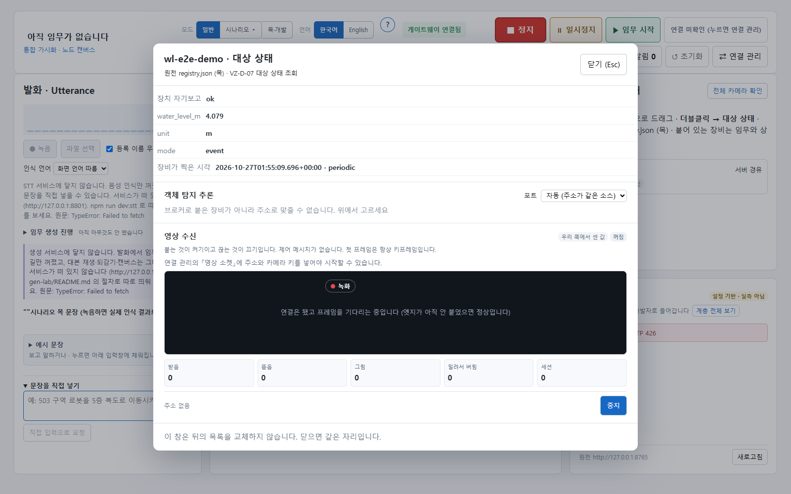

# 전 구간(E2E) 시험 — 말단 → 중앙 → 관제 화면

> 헬스체크(`healthcheck.sh`)는 **중앙 스택이 흐르는가**를 시험용 발행기로 본다. 이 문서의 시험은 한 단계 더 나가서
> **Pi 에서 도는 실제 말단 노드 코드**를 중앙에 붙이고, **관제 화면과 같은 방식으로** 받아 본다.

## 1. 장비 없는 E2E — `deploy/scripts/e2e-sim.sh`

```bash
cd deploy
docker compose up -d --wait && ./scripts/seed-demo.sh   # 중앙 스택
./scripts/e2e-sim.sh                                    # 약 1분
```

| 층 | 무엇이 도나 | 실물과 다른 것 |
|---|---|---|
| 말단 | `hardware/pi/sensor/sensor_node.py` 그대로 (공통 코어 · 버퍼 · OTel 포함) — `python:3.12-slim` 컨테이너, Pi 와 같은 라이브러리 | 센서 입력만 노드에 내장된 가짜 수위 센서 + 강우 스위치(`/tmp/rain`) |
| 전송 | 노드 → 중앙 Mosquitto(1883) → `be-ingest` → Kafka → `be-storage` · `be-gateway` | 터널 대신 도커 망 |
| 관제 | `/state` 에 VZ 앱(`viz-debugger` `WsTransport`)과 같은 구독 메시지를 보내고 `{type:"data"}` 봉투를 받는다 | 브라우저 대신 스크립트(같은 와이어 형식) |

검사 항목 — 평시 주기 보고 도착 · 강우 ON → 임계 초과 · 고주기(event) 전환 · 강우 OFF → 임계 해제 · 평시 복귀 ·
TimescaleDB 에 화면이 받은 만큼 이상 적재 · 사건 행 · MySQL 레지스트리 관측 등록 · 노드 metric 이 Prometheus 에 도착.
CI(`deploy-smoke`)가 매 PR 마다 헬스체크 다음에 돌린다.

### 2026-10-27 기록

빈 환경에서 `main` 으로 세운 스택(healthcheck 32/32) 위에서:

```
▶ 1. 평시 — 주기 보고가 관제 구독에 도착
  ✅ periodic 상태 도착 (/state · VZ 형식)
▶ 2. 사건 — 강우 스위치 ON
  ✅ 임계 초과(threshold_exceeded) 도착
  ✅ 고주기(event) 전환이 화면까지
▶ 3. 해제 — 강우 스위치 OFF
  ✅ 임계 해제(threshold_cleared) 도착
  ✅ 평시(normal) 복귀
     관제 구독 수신 27건 · 발행→화면 지연 중앙값 9ms · 최대 1009ms
▶ 4. 저장 — 같은 값이 남는가
  ✅ TimescaleDB state 27행 (화면 수신 27건 이상)
  ✅ TimescaleDB 사건 행 threshold_exceeded
  ✅ TimescaleDB 사건 행 threshold_cleared
  ✅ MySQL 레지스트리 관측 등록
▶ 5. 관측 — 노드 자신의 metric
  ✅ Prometheus hw_publish_count_total{exported_instance=wl-e2e-…}
```

최대 지연 1009ms 는 노드가 브로커 접속 전에 버퍼에 쌓았다가 재전송한 첫 건이다(HW-R-09 — 의도된 동작).

**실제 관제 화면으로도 확인했다.** 같은 스택에 `visualization/viz-debugger` 를 띄우고 연결 관리에서 게이트웨이를
`ws://127.0.0.1:8765/state?token=…`, 구역을 `zoneA` 로 두자 노드가 「연결됨 · 서버 경유」로 떴고, 강우 중 대상 상태
창의 값(`water_level_m 4.079 · mode event`)이 노드 로그의 같은 시각 값과 일치했다.

| 하드웨어 카드 | 대상 상태 (강우 중) |
|---|---|
|  |  |

### 이 시험이 보지 않는 것

- **물리 센서·로봇 자체** — 센서 결선, Go1/EP SDK, 카메라. 아래 2절의 실장비 시험이 필요하다.
- **명령 경로(관제 → 장치)** — 백엔드 명령 번역(BE-X)이 아직 없다. 노드의 명령 수신은 `hardware/pi/bench/` 시험이 따로 본다.
- **노드 log** — 노드는 log 를 OTel 로 내보내지 않는다(Pi 의 journald). trace 는 명령 경로에만 있다.
- **영상** — `/ingest` → `/media` 는 백엔드 회귀(`test_media_relay.py`)가 본다.

## 2. 실장비 E2E (1.0 체크리스트 — 아직 기록 없음)

장비가 있는 곳에서 한 번 기록한다. 절차는 위와 같고 말단만 바꾼다:

1. Pi 에 [`hardware/docs/EDGE_SETUP.md`](../../hardware/docs/EDGE_SETUP.md) 대로 노드를 설치하고
   `install-units.sh --user <사용자>` 로 유닛을 깐다. `/etc/hw-node.env` 의 `HW_BROKER_HOST` 를 중앙(또는 엣지) 주소로.
2. 중앙에서 위 스크립트의 「관제 구독」 부분과 같은 것을 보거나, `viz-debugger` 연결 관리에서 게이트웨이를 중앙으로 둔다.
3. 센서에 실제 변화를 준다(수위 · 강우 스위치) — 임계 초과/해제가 화면과 DB 에 오는지, 지연은 얼마인지 적는다.
4. 로봇(Go1/EP) 1대를 붙여 `robot/state` 가 같은 경로로 오는지 본다.
5. 결과를 이 절에 「YYYY-MM-DD 기록」으로 남긴다.
