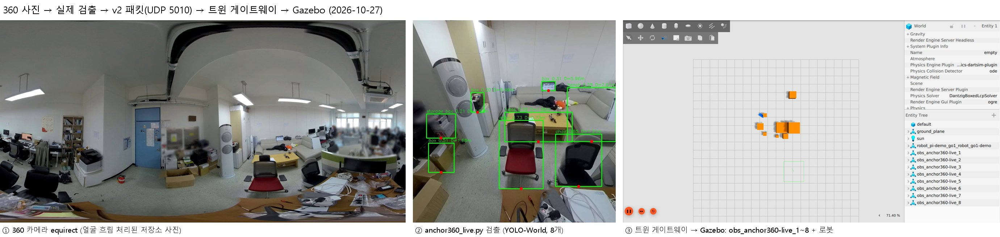
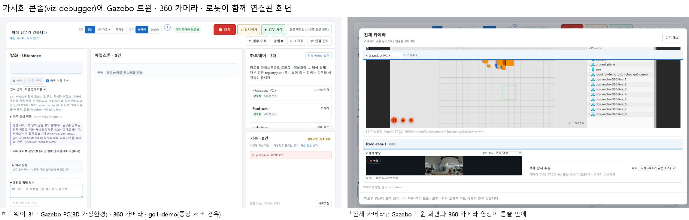
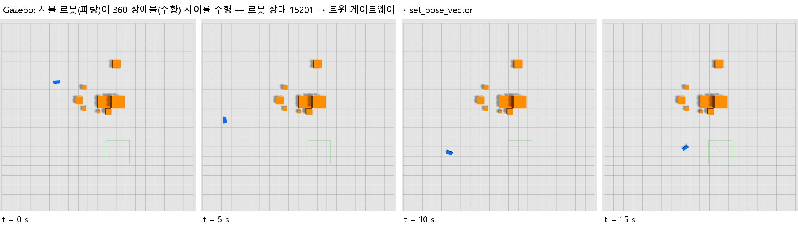

# 트윈 시연 — 360 카메라 · 가시화 콘솔 · Gazebo 연동 기록

Unity 대신 Gazebo 를 디지털 트윈으로 붙여, 실제 코드 경로로 다음이 이어지는지 확인한 기록이다
(2026-10-27, v1.0.0-rc.2 + 트윈 게이트웨이 수정).

- 360 카메라 사진 → 스트림 서버 → **가시화 콘솔**에 360 영상
- 같은 사진 → `anchor360_live.py` 검출 → v2 패킷 → 트윈 게이트웨이 → **Gazebo** 에 장애물
- 시뮬 로봇 노드 → 중앙 MQTT → **콘솔**에 상태, 같은 로봇 → 상태 중계 → 게이트웨이 → **Gazebo** 에서 주행
- 콘솔의 「3D 가상환경」 칸(원래 Unity 화면 자리)에 **Gazebo 화면**

## 구성

```
360 사진(equirect) ─upload_equirect.py─> server_stream_multi_source.py :10001 ──MJPEG──> 콘솔 「카메라」
        └──────────────> anchor360_live.py (YOLO-World) ──UDP 5010 v2──> twin_gateway ──> Gazebo
시뮬 로봇 go1-demo ──MQTT──> 중앙 스택 (Kafka · DB · 게이트웨이 /state) ──WebSocket──> 콘솔 「하드웨어」
        └──UDP 15200──> robot_state_relay ──UDP 15201──> twin_gateway ──> Gazebo
Gazebo 화면 ──noVNC 6080──> 콘솔 「3D 가상환경」
```

## 결과

### 1. 360 사진 → 실제 검출 → Gazebo



저장소의 360 사진(`camera360/image backup/br40_live.jpg`, 얼굴 흐림 처리됨)을 `anchor360_live.py` 가
처리해 장애물 8개(의자 2 · 상자 3 · 수납함 · 탁자 · 벤치)를 v2 패킷으로 보냈고, 게이트웨이가
`obs_anchor360-live_1` ~ `_8` 로 Gazebo 에 만들었다. 게이트웨이 실패 기록 0건.

### 2. 가시화 콘솔에 Gazebo · 360 카메라 · 로봇



콘솔(`visualization/viz-debugger`)의 하드웨어 목록에 셋이 함께 뜬다.

| 카드 | 경로 | 콘솔 설정 |
|------|------|-----------|
| `<Gazebo PC>` 3D 가상환경 | noVNC 화면 | 연결 관리 → 3D 가상환경 주소 |
| `fixed-cam-1` 카메라 | 스트림 서버 `:10001/stream` (360 영상) | 연결 관리 → 카메라 |
| `go1-demo` 서버 경유 | 중앙 게이트웨이 `/state` (zoneA) | 연결 관리 → 게이트웨이, 구역 `zoneA` |

「전체 카메라」에서 Gazebo 트윈 화면과 360 영상을 같이 본다. 캡처의 PC 이름은 가렸다.

### 3. Gazebo 에서 로봇 주행



시뮬 로봇에 중앙 MQTT 로 임무(`assign_mission`)를 주자 원을 그리며 달렸고, 콘솔에는 mission 모드 ·
속도 0.8 m/s 로, Gazebo 에는 위치·방향으로 나타났다.

## 이 시연에서 찾아 고친 것

- **게이트웨이 Gazebo 호출 묶음.** 처음 판은 엔티티마다 `gz service` 를 한 번씩 불렀다(호출 하나 ~0.3 s).
  10 Hz 로봇과 장애물이 같이 들어오면 호출이 밀려 시간 초과가 쌓였다(966건). 틱마다
  `create_multiple` 한 번, `set_pose_vector` 한 번으로 묶어 고쳤다. 다시 돌린 회귀 시험(로봇 생성·이동,
  장애물 생성·삭제)과 이 시연에서 실패 0건.
- **`gz` 를 못 찾으면 조용히 멈추던 것.** 서비스 호출 스레드가 예외로 죽었다. 이제 기록하고 계속한다.
- **가상 화면 GUI 의 CPU.** 컨테이너 안 소프트웨어 렌더링이 코어 8개를 써서 Gazebo 서버가 굶었다.
  시연 스크립트는 GUI 렌더러를 `ogre` 로, `LP_NUM_THREADS=2` 로 묶는다(실제 GPU 가 있는 PC 에서는 필요 없다).
- `anchor360_live.py` 시작 문구가 받는 곳을 `주소:포트:포트` 로 찍던 것.

## 다시 해 보기

중앙 스택이 떠 있는 기기에서, 저장소 루트로:

```
hardware/twin/demo/run-demo.sh                     # Gazebo · 게이트웨이 · 시뮬 로봇 (컨테이너 twin-demo)
python camera360/server_stream_multi_source.py --on cam360
python camera360/upload_equirect.py --watch <360 사진 폴더>          # 또는 사진을 되풀이해 올린다
python camera360/anchor360_live.py --watch-dir <pano_receiver 저장 폴더> --unity-ip 127.0.0.1:25010
cd visualization/viz-debugger && npm run dev       # 연결 관리에서 위 표대로 넣는다
```

Gazebo 화면: <http://127.0.0.1:6080/vnc.html?autoconnect=1&resize=scale>. 기록은 ROS 2 Jazzy + Gazebo
Harmonic(gz sim 8.11) 이 든 로컬 이미지로 남겼다. `run-demo.sh` 의 기본 이미지(`osrf/ros:jazzy-desktop-full`)
로는 아직 돌려 보지 않았다.

## 한계 (사실대로)

- **콘솔과 Gazebo 는 서로 데이터를 주고받지 않는다.** 콘솔은 Gazebo 화면을 띄울 뿐이다(Unity 와 같은 방식).
  같은 로봇이 두 경로(중앙 서버 · 트윈 중계)로 양쪽에 나타난다. 게이트웨이가 중앙 `/state` 를 구독하게 하면
  한 출처로 묶을 수 있다(다음 단계).
- **콘솔은 로봇의 x · y 를 보여 주지 않는다.** 위치가 맞는지는 Gazebo 쪽 값으로 확인했다.
- **Gazebo 에서 로봇을 움직이는 명령 경로는 없다.** 보기만 한다.
- 모두 시뮬레이션이다. 실제 360 카메라 · Pi · Go1 로는 아직 하지 않았다.
- 360 장애물의 월드 배치는 카메라 자리(`anchors`) 기본값이다. 실제 설치에서는 카메라 위치·방위를 넣어야 한다.
